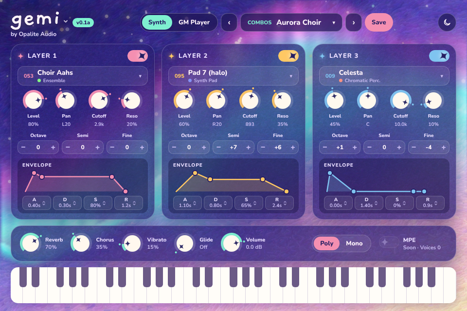

# GM Synth

A VST3 / AU / Standalone instrument with the complete General MIDI sound set built in.
No SoundFont files to find, install or point at: the samples are compiled into the plugin.

Every one of the classic 128 GM instruments is there, from Acoustic Grand Piano to
Seashore, Helicopter, Applause and Gunshot, plus 13 drum kits (Standard, Room, Power,
Electronic, 808/909, Jazz, Brush, Orchestral, SFX and more) and 146 GS variation tones.

"GM Synth" and "Your Company" are placeholders: set your own brand in `CMakeLists.txt`
(see [Before you sell it](#before-you-sell-it)).



## What it does

- **16 MIDI channels**, multitimbral, channel 10 is drums, exactly like a hardware GM module.
  Drop it on a track, feed it a `.mid` file, and it plays back like a 90s sound card.
- **Program change, bank select (GS variations), pitch bend, mod wheel, volume, pan,
  expression, sustain, reverb/chorus send (CC91/CC93), RPNs and GM/GS SysEx resets** all work.
- **Reverb and chorus** built in, with master Reverb / Chorus / Volume knobs.
- **Per-channel instrument picker** in the UI, so you can choose sounds without sending
  program changes. The choices are saved with your project.
- **On-screen keyboard**: click a channel number to play that channel.
- **GM Reset**, **All Sound Off** and an **About** box with the license credits.

## How it works

| Piece | What it is | License |
| --- | --- | --- |
| [JUCE 9](https://juce.com) | Plugin framework (VST3, AU, Standalone) | AGPLv3 or JUCE commercial licence |
| VST3 SDK (bundled with JUCE) | VST3 plugin interface | MIT |
| [FluidSynth 2.5.7](https://www.fluidsynth.org) | The SoundFont engine: the reference SF2 player, with reverb, chorus and full modulator support | LGPL-2.1 |
| [GeneralUser GS 2.0.3](https://www.schristiancollins.com/generaluser) by S. Christian Collins | The 32 MB GM/GS sound bank, embedded in the plugin binary | Free for commercial use, may be bundled in software |

FluidSynth is built without glib or audio drivers, as a **shared library shipped inside
each plugin bundle**. Linking it dynamically is what lets you sell the plugin as closed
source while meeting the LGPL. The SoundFont is fed to it straight from memory.

Source layout:

- `Source/GMSynth.*`: the sound module (FluidSynth + embedded SoundFont, MIDI handling). No JUCE dependency.
- `Source/PluginProcessor.*`: the plugin: sample-accurate MIDI, parameters, state saving.
- `Source/PluginEditor.*`: the UI.
- `tools/gm_render.cpp`: renders a tour of all 128 instruments and every drum kit to a WAV and checks levels.
- `Licenses/`, `THIRD_PARTY_NOTICES.md`: copied into every bundle by the build.

## Building

Requirements: CMake 3.22+, a C++17 compiler, Git. JUCE and FluidSynth are downloaded
automatically by CMake on the first configure.

```sh
cmake -S . -B build -DCMAKE_BUILD_TYPE=Release
cmake --build build --config Release --parallel
```

macOS (needed for the AU; this makes a universal Intel + Apple Silicon binary):

```sh
cmake -S . -B build -DCMAKE_BUILD_TYPE=Release -DCMAKE_OSX_ARCHITECTURES="arm64;x86_64"
cmake --build build --parallel
```

Linux needs the usual JUCE packages:

```sh
sudo apt install libasound2-dev libx11-dev libxrandr-dev libxinerama-dev libxcursor-dev \
  libxext-dev libxi-dev libxcomposite-dev libxrender-dev libfreetype-dev libfontconfig1-dev
```

The first build takes a few minutes, mostly compiling the 32 MB SoundFont into the binary.

Built plugins land in `build/GMSynth_artefacts/Release/` (with the default name):

- `VST3/GM Synth.vst3`: copy to `~/Library/Audio/Plug-Ins/VST3` (macOS),
  `C:\Program Files\Common Files\VST3` (Windows) or `~/.vst3` (Linux)
- `AU/GM Synth.component` (macOS): copy to `~/Library/Audio/Plug-Ins/Components`
- `Standalone/`: a standalone app that takes MIDI from any connected controller or
  virtual port. Keep the FluidSynth library and `Licenses` folder next to it.

Each plugin is a self-contained bundle (about 39 MB), FluidSynth library included.

The GitHub Actions workflow (`.github/workflows/build.yml`) builds macOS, Windows and
Linux on every push, runs the engine test, and uploads the plugins as artifacts.

## Testing the engine

```sh
cmake --build build --target gm_render
./build/gm_render tour.wav               # every instrument, then every drum kit
./build/gm_render gunshot.wav 127 127    # just Gunshot (program numbers are 0-based here)
```

It prints the peak and RMS level of each instrument and exits non-zero if any is silent,
clipping or produces NaNs.

## Before you sell it

This is not legal advice; read each license yourself, and talk to a lawyer if the
product matters to you.

1. **Your brand.** In `CMakeLists.txt` set `GM_PRODUCT_NAME`, `GM_COMPANY_NAME`,
   `GM_COMPANY_WEBSITE`, `GM_BUNDLE_ID` and pick your own `GM_MANUFACTURER_CODE` and
   `GM_PLUGIN_CODE` (4 characters each, at least one upper-case letter). Never change the
   codes after release, or hosts will treat updates as a different plugin. Don't use other
   companies' trademarks in the name (for example Roland, Sound Canvas, or the General MIDI
   logo); describing it as "General MIDI compatible" is the usual approach.
2. **JUCE licence.** Selling closed-source software built with JUCE needs a JUCE
   commercial licence, unless you release your own source under the AGPLv3. JUCE offers
   tiers based on your revenue, including a free one for small businesses: check the
   current terms at https://juce.com/get-juce before you release.
3. **FluidSynth (LGPL-2.1).** Already handled by the build: it ships as a separate,
   replaceable library, and the license and notice files go in every bundle. You also need to:
   - keep `Licenses/` and `THIRD_PARTY_NOTICES.md` with every copy (installer included),
   - make the FluidSynth 2.5.7 source available (linking to the upstream release, plus
     keeping a copy of the tarball yourself, is the safe way),
   - not forbid reverse engineering for the purpose of debugging changes to FluidSynth in
     your EULA, and allow users to swap the library.
4. **GeneralUser GS.** Its license allows commercial use and bundling in software. The
   author notes that some samples came from other freely available banks and that he can't
   be 100% certain of every sample's origin, though nobody has complained since 2000. If
   that risk matters for your product, plan to replace the bank later with samples you own
   or license; the engine plays any SF2.
5. **VST3.** The SDK bundled with JUCE 9 is MIT licensed, so no Steinberg agreement is
   needed. Follow Steinberg's logo/trademark usage guidelines if you show the VST logo.
6. **Code signing.** macOS: sign the bundles (`codesign --deep` with a Developer ID
   Application certificate, after the build has copied FluidSynth in), then notarize with
   `notarytool`. This needs an Apple Developer account. Windows: sign the `.vst3` and
   `.exe` with an Authenticode certificate to avoid SmartScreen warnings.
7. **Pro Tools (optional).** AAX needs Avid's AAX SDK and PACE signing, which JUCE
   supports; add `AAX` to `GM_FORMATS` once you have them.
